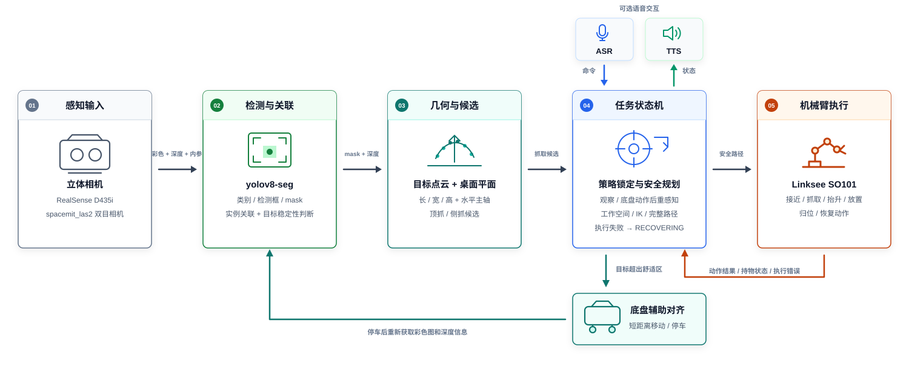

# perceptive_grasp

`perceptive_grasp` 是一套面向桌面场景的闭环视觉抓取方案。系统从 RGB-D 图像中识别目标、恢复其三维位置与形态，并据此选择抓取方式、验证运动路径和驱动机械臂完成抓取与放置。

观察姿态或底盘位置改变后，系统重新感知场景并更新计划；任务异常时进入安全恢复流程。目标超出舒适抓取区时，底盘完成短距离对齐，系统在停车后重新感知并更新计划。

语音交互作为可选入口，用于下发任务和播报执行状态。

下图以 Linksee 真机抓取为主线，展示从 RGB-D 感知、目标检测与关联、三维几何估计到安全规划和机械臂执行的完整闭环。



同一套 pipeline 支持三种部署方式，共用感知、规划、任务控制和语音接口。

| 部署方式 | 设备及执行后端 | 部署位置 |
| --- | --- | --- |
| Linksee 真机 | `manipulation` 控制 SO101 与夹爪；`libchassis` 控制底盘 | K3 |
| MuJoCo 同机部署 | UR5e + Robotiq 2F-85 仿真（`manipulation`） | 仿真服务与 pipeline 在同一台 PC 或 K3 |
| MuJoCo 跨机部署 | UR5e + Robotiq 2F-85 仿真（`manipulation`） | 服务在 PC，pipeline 在 K3 |

真机使用 `config/grasp_pipeline.yaml`，RGB-D 输入选择 RealSense D435i 或 `spacemit_las2`。

本文的仿真部署采用独立的仿真服务和抓取 pipeline，分别读取以下配置：

- **仿真服务**（`mujoco_grasp_sim_server`）：`config/grasp_pipeline_manipulation_mujoco.yaml`，配置仿真场景、模拟 RGB-D 相机和仿真设备。
- **抓取 pipeline**（`perceptive_grasp`）：`config/grasp_pipeline_manipulation_remote.yaml`，配置服务连接、感知和任务参数。

同机部署直接连接 `127.0.0.1:9090`；跨机部署通过 SSH 端口转发连接 PC 上的服务，K3 的 pipeline 仍使用该回环地址。

## 1. 功能范围

`perceptive_grasp` 提供以下功能：

- 支持 RealSense D435i 和 `spacemit_las2` 两种真机 RGB-D 后端，以及本地和远程 MuJoCo RGB-D 后端。
- 使用 YOLOv8-Seg 检测和分割目标，并在连续感知过程中关联目标实例；仿真配置可使用实例颜色辅助分割。
- 根据分割掩码和深度信息估计目标点云、桌面平面、三维尺寸和水平主轴。
- 根据目标三维形状和候选可执行性选择顶抓或侧抓，并生成对应抓取路径。
- 在规划阶段控制底盘短距离调整位置，停车后重新感知和规划。
- 在机械臂动作前验证工作空间、逆运动学、关节限制、桌面间隙和完整路径。
- 执行接近、夹取、抬升或退出、放置、归位和失败恢复动作。
- 可通过本地语音桥接收抓取、取消和结束命令，并播报任务状态。

本方案面向桌面或近距离场景中的单目标抓取。底盘辅助不包含导航、避障和全局路径规划。

## 2. 系统组成

| 模块 | 实现 | 作用 |
|---|---|---|
| RGB-D 输入 | RealSense D435i / `spacemit_las2` / MuJoCo | 输出像素对齐的彩色图像、深度图和相机内参 |
| 目标检测 | `vision_service` / OpenCV DNN | 运行 YOLOv8-Seg，输出目标类别、检测框和分割掩码 |
| 任务控制 | `grasp_pipeline` | 组织目标关联、策略锁定、观察或底盘动作后的重感知、机械臂执行和失败恢复 |
| 抓取规划 | `grasp_planner` / `grasp_geometry` | 估计目标点云和桌面平面，生成并验证顶抓或侧抓候选 |
| 机械臂执行 | `manipulation` | 统一控制 Linksee SO101 或仿真机械臂和夹爪 |
| 手眼标定 | `manipulation` 标定会话 | 采集静止姿态与图像，求解和导出相机外参 |
| 底盘辅助 | `libchassis` | 调整机器人与目标的相对位置 |
| 语音交互 | `spacemit_audio` / VAD / ASR / TTS | 接收语音命令并播报任务状态 |
| MuJoCo 仿真 | UR5e / Robotiq 2F-85 场景 | 运行物理仿真、模拟 RGB-D 相机与抓取执行器 |

MuJoCo 模式通过仿真相机与仿真执行器替代真实硬件。机械臂与夹爪分别使用 `mujoco_ur5e` 和 `mujoco_robotiq_2f85` 驱动，与真机模式使用相同的设备接口。

## 3. 准备环境

真机部署按以下顺序准备；仅运行仿真时，直接按[仿真运行](#7-仿真运行)安装依赖和构建。

1. 按[方案依赖](docs/sdk_dependencies.md)下载源码，安装系统依赖，构建依赖组件，并获取视觉和语音模型。
2. 按[硬件部署](docs/hardware_setup.md)连接 RGB-D 相机、机械臂、底盘和音频设备。

## 4. 配置

主配置文件为 [`config/grasp_pipeline.yaml`](config/grasp_pipeline.yaml)。首次部署时至少完成以下配置：

1. 在 `config/devices/linksee_so101.yaml` 的机械臂、夹爪 `options.port` 中填写同一个稳定串口路径；底盘串口仍在主配置中设置。
2. 选择 RGB-D 输入后端，并填写设备、模型和标定参数。LAS2 还须在 `camera.spacemit_las2.serial` 登记本台相机的序列号或固定资产编号。
3. 完成 eye-to-hand 标定，更新当前相机后端对应的手眼标定结果。
4. 根据实际音频设备更新 ASR 和 TTS 设备编号。

将本台 SO101 的舵机校准文件放入应用配置目录，不使用其他设备的偏置和行程：

```bash
cd ~/spacemit_robot/application/ros2/linksee/perceptive_grasp
read -erp "本台 SO101 校准文件目录: " SO101_CALIBRATION
cp -n "$SO101_CALIBRATION/so101_calibration.json" config/devices/
cp -n "$SO101_CALIBRATION/so101_gripper_calibration.json" config/devices/
```

各类配置的职责如下，路径均相对各自配置文件解析：

| 配置 | 内容 |
| --- | --- |
| 设备配置 | 驱动、连接、限位和夹爪端点 |
| `manipulator.model` | 关节链 |
| `manipulator.calibration_resources` | 标定采集绑定的校准文件 |

首次使用须先通过 `so101-calibrate` 完成舵机校准。手眼标定不代替舵机校准。

固定相机和末端标定板后，采集 15 个静止姿态并求解外参：

```bash
source ~/spacemit_robot/build/envsetup.sh
source ~/.venv-grasp/bin/activate
python3 scripts/calibrate_hand_eye.py --installation-id linksee_site \
  --charuco-squares-x 4 --charuco-squares-y 5 \
  --charuco-square-length 0.020 --charuco-marker-length 0.014 \
  --num-poses 15 --dataset-dir output/hand_eye
python3 scripts/calibrate_hand_eye.py --solve-only --installation-id linksee_site \
  --dataset-dir output/hand_eye --apply-config config/grasp_pipeline.yaml
```

示例使用 4 × 5 ChArUco 板，方格 20 mm、标记 14 mm；参数须与实测尺寸一致。

- **采集操作**：按现场规程调整姿态并停止，退出其他控制程序后输入 `CAPTURE`。采集只读取设备，不使能、不释放力矩、不运动。
- **安装要求**：标定板须相对模型末端刚性固定，采集期间不得改变夹爪开度。
- **数据管理**：数据目录不可覆盖；采集与导出使用同一安装标识。

标定板生成和质量要求见[手眼标定](docs/hand_eye_calibration.md)。

## 5. 构建、安装与检查

### 5.1 构建并安装 K3 程序

先按[方案依赖](docs/sdk_dependencies.md#4-构建-sdk-组件)安装底盘、视觉和 `manipulation` 组件。以下配置包含 VisionService、真实硬件执行器、RealSense 后端以及本机和远程 MuJoCo：

```bash
cd ~/spacemit_robot
source build/envsetup.sh
cd application/ros2/linksee/perceptive_grasp
cmake -S . -B build \
  -DCMAKE_BUILD_TYPE=Release \
  -DCMAKE_INSTALL_PREFIX="$PREFIX" \
  -DCMAKE_PREFIX_PATH="$PREFIX" \
  -DOpenCV_DIR=/usr/lib/riscv64-linux-gnu/cmake/opencv4 \
  -DX86_STANDALONE=OFF \
  -DUSE_OPENCV_DNN=OFF \
  -DUSE_MOCK_EXECUTOR=OFF \
  -DENABLE_MUJOCO_EXECUTOR=ON \
  -DENABLE_REMOTE_MUJOCO=ON \
  -DENABLE_LAS2_CAMERA=OFF \
  -DENABLE_WEBRTC_AEC=OFF \
  -DENABLE_ROS2_VOICE=OFF
cmake --build build -j2
cmake --install build
```

程序安装到 `$PREFIX/bin`，配置、URDF、场景和脚本安装到 `$PREFIX/share/perceptive_grasp`。`perceptive_grasp` 是结构化日志启动器，`perceptive_grasp_core` 是运行 pipeline 的 C++ 程序；正常运行使用启动器。`debug_grasp` 提供感知与规划诊断入口。

LAS2、WebRTC 软件回声消除和 ROS 2 语音话题桥是可选功能。准备对应依赖后，重新配置相应的 `ENABLE_*` 选项并构建安装。本地语音桥不依赖 ROS 2 语音话题桥；上述构建使用语音时，将配置中的 `voice.echo_cancellation.mode` 设为 `half_duplex`，或使用音频设备提供的 `hardware_aec`。

### 5.2 检查安装与配置

以下命令只显示帮助或检查配置，不初始化相机、机械臂或底盘：

```bash
"$PREFIX/bin/perceptive_grasp" --wrapper-help
"$PREFIX/bin/perceptive_grasp" \
  --config "$PREFIX/share/perceptive_grasp/config/grasp_pipeline.yaml" \
  --validate-config
"$PREFIX/bin/debug_grasp" --help
```

输出包含 `[Config] valid` 时，配置结构和字段取值通过检查。该检查不确认模型文件、设备连接或现场标定结果。

后续现场配置和运行示例使用源码目录中的 `config/`。安装程序也可通过 `--config` 使用该目录；修改后的配置需要重新安装，才会更新 `$PREFIX/share/perceptive_grasp/config/`。

### 5.3 检查真机运行环境

完成硬件部署、模型下载和设备配置后，执行只读运行环境检查：

```bash
source ~/.venv-grasp/bin/activate
python3 scripts/check_runtime_env.py \
  --config config/grasp_pipeline.yaml \
  --build-dir "$PREFIX/bin" \
  --no-fix
```

检查脚本会同时验证启动器和核心程序。环境可运行时，最后一行显示：

```text
[SUMMARY] ready
```

## 6. 运行抓取

**以下命令会驱动机械臂和底盘。启动前清理机器人工作空间，确认急停和断电装置可用，并保持人员远离运动范围。**

确认机械臂空载、支撑可靠后，使能机械臂和夹爪。使能会产生保持力矩；应用不自动使能设备。

```bash
cd ~/spacemit_robot/application/ros2/linksee/perceptive_grasp
source ~/spacemit_robot/build/envsetup.sh
manipulation inspect --plan config/devices/linksee_so101.yaml
manipulation enable --plan config/devices/linksee_so101.yaml
manipulation hand-enable --plan config/devices/linksee_so101.yaml
```

抓取指定目标：

```bash
cd ~/spacemit_robot/application/ros2/linksee/perceptive_grasp
source ~/spacemit_robot/build/envsetup.sh
"$PREFIX/bin/perceptive_grasp" \
  --config config/grasp_pipeline.yaml \
  --target banana
```

连续抓取：

```bash
"$PREFIX/bin/perceptive_grasp" \
  --config config/grasp_pipeline.yaml \
  --target banana \
  --loop
```

连续抓取次数没有上限。每轮完成或失败恢复后，pipeline 返回观察位并立即检测下一轮目标。

- 指定 `--target` 时只处理该类别；省略该参数时选择画面中稳定的最佳候选。
- 循环模式不区分上一轮目标，视野内满足条件的目标可以再次被抓取。
- 按一次 `Ctrl+C` 后，程序停止启动下一轮，完成安全归位后退出。

排查 RGB-D 输入、OpenCL、机械臂、运动学或底盘驱动时增加 `--debug` 来查看更多日志：

```bash
"$PREFIX/bin/perceptive_grasp" \
  --config config/grasp_pipeline.yaml \
  --target banana \
  --debug
```

启动本地语音控制前，按[语音控制](docs/voice_control.md)准备模型和音频设备，并选择与构建匹配的回声处理方式：

```bash
source ~/.venv-grasp/bin/activate
"$PREFIX/bin/perceptive_grasp" \
  --voice-control \
  --config config/grasp_pipeline.yaml
```

使用 Qwen3-ASR 后端启动真机语音抓取：

```bash
source ~/.venv-grasp/bin/activate
"$PREFIX/bin/perceptive_grasp" \
  --voice-control \
  --asr-backend qwen3_asr \
  --config config/grasp_pipeline.yaml
```

命令行参数只覆盖本次运行使用的 ASR 后端，不修改配置文件中的默认值。

## 7. 仿真运行

示例使用 UR5e、Robotiq 2F-85 和固定式 RGB-D 相机，将绿色区域内的物体搬运到红色区域。

- **部署方式**：仿真服务与 pipeline 在同一台 PC 或 K3 运行；跨机时由 PC 运行仿真服务，K3 运行 pipeline。
- **设备后端**：使用 `manipulation` 共享仿真，机械臂、夹爪和模拟 RGB-D 相机共用一个物理世界，不连接真实设备。

### 7.1 安装与构建

在 SDK 根目录执行。显示窗口和模拟相机均需要 X11 桌面会话；K3 使用带 EGL/GLES 图形驱动的桌面镜像，并先登录桌面。

```bash
sudo apt update
sudo apt install -y build-essential cmake pkg-config git python3 ca-certificates libopencv-dev \
  libyaml-cpp-dev liburdfdom-dev libglfw3-dev libgl1-mesa-dev libx11-dev
cd application/ros2/linksee/perceptive_grasp
python3 scripts/run_manipulation_simulation.py build
```

构建自动获取缺失的 MuJoCo 和场景资源，构建产物放在 `build_manipulation/`，不覆盖真机安装。

K3 使用 X11/gl4es，PC 使用 GLFW/OpenGL。示例启用仿真颜色分割，未安装 YOLO 模型时也可运行；此设置不用于真机。

已按第 5 节安装 K3 程序时，可直接使用安装的仿真服务与客户端，无需另建示例目录。启动命令见[安装目录运行](docs/simulation.md#安装目录运行)。该构建使用 VisionService，需按[方案依赖](docs/sdk_dependencies.md#5-准备检测模型)准备 YOLO 模型和标签。

### 7.2 本机运行

同机部署在一台 PC 或 K3 上分别启动服务和 pipeline。`serve` 读取服务配置 `config/grasp_pipeline_manipulation_mujoco.yaml`：

```bash
python3 scripts/run_manipulation_simulation.py serve
```

保持服务运行，在同一目录的另一终端执行。`grasp` 读取客户端配置 `config/grasp_pipeline_manipulation_remote.yaml`，通过 `127.0.0.1:9090` 连接服务：

```bash
python3 scripts/run_manipulation_simulation.py grasp apple
```

目标可选 `apple`、`banana`、`cube`、`cup`；前三种使用顶抓，杯子使用侧抓。

- **窗口操作**：鼠标旋转、平移和缩放；`serve --no-viewer` 关闭窗口，但模拟相机仍需要图形上下文。
- **场景状态**：切换目标保留场景状态，重新启动服务恢复初始场景。

### 7.3 PC 显示、K3 远程抓取

跨机部署沿用同机部署的两份配置。PC 按第 7.2 节启动仿真服务；K3 运行 pipeline，通过 SSH 端口转发连接服务。在 K3 的 SDK 根目录执行：

```bash
sudo apt update
sudo apt install -y build-essential cmake pkg-config python3 openssh-client \
  libopencv-dev libyaml-cpp-dev liburdfdom-dev
cd application/ros2/linksee/perceptive_grasp
python3 scripts/run_manipulation_simulation.py build --client-only
read -rp "PC SSH 地址（用户@主机）: " SIM_PC
ssh -N -L 9090:127.0.0.1:9090 "$SIM_PC"
```

保持 SSH 转发，在 K3 同一目录的另一终端执行：

```bash
python3 scripts/run_manipulation_simulation.py grasp apple --client-only
```

K3 客户端不需要本机显示器或 MuJoCo。服务仅监听回环地址；SSH 转发将 K3 的 `127.0.0.1:9090` 接到 PC 的同一端口，客户端配置无需改为 PC 的 IP 地址。

抓持在双指接触后建立约束，是仿真简化，不代表纯摩擦抓持或真机抓稳结果。

仿真服务统一使用 `manipulation` 的设备控制、物理世界与渲染接口。服务地址、场景配置和语音接入见[仿真运行](docs/simulation.md)。

## 8. 文档导航

- [方案依赖](docs/sdk_dependencies.md)（操作指南）：安装依赖、构建 SDK 组件、准备检测和语音模型。
- [硬件部署](docs/hardware_setup.md)（操作指南）：连接硬件、配置设备权限、验证 RGB-D 相机和串口。
- [抓取配置](docs/grasp_config.md)（参考）：说明配置文件字段、默认值、单位和约束。
- [手眼标定](docs/hand_eye_calibration.md)（操作指南）：生成标定板、采集数据、求解并写回标定结果。
- [语音控制](docs/voice_control.md)（操作指南）：配置 ASR/TTS 并启动本地语音桥。
- [仿真运行](docs/simulation.md)（操作指南）：将仿真服务与 pipeline 部署在同一台 PC 或 K3，或分别部署在 PC 和 K3。
- [故障诊断](docs/debugging.md)（操作指南）：定位感知、规划、执行、底盘和性能问题。
- [pipeline 状态机](docs/pipeline_state_machine.md)（说明）：介绍状态转换、异步动作、输出事件和失败终态。
- [抓取方案](docs/grasping_approaches.md)（说明）：介绍感知定位、抓取规划、底盘介入条件和方案边界。

## 9. 许可证与第三方资源

`perceptive_grasp` 使用 [Apache License 2.0](../LICENSE)。MuJoCo 模型、网格和纹理的来源、固定版本及许可证见[仿真资源声明](simulation/mujoco/LICENSES.md)。
