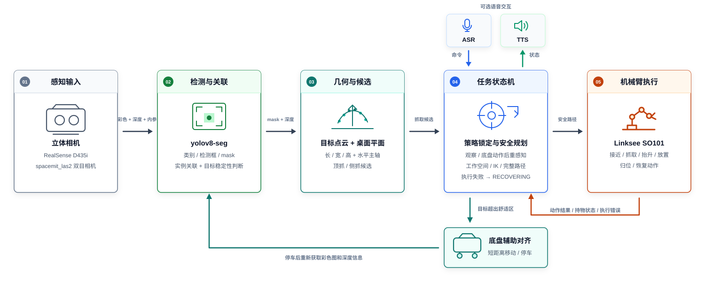

# 抓取方案

`perceptive_grasp` 采用基于立体视觉的单目标抓取方案：先检测并关联目标，再用分割掩码和深度估计三维几何；规划器按目标形状选择顶抓或侧抓，并在机械臂动作前完成底盘对齐和完整路径验证。

## 1. 实现链路

一轮抓取由两个感知阶段和一个动作闭环组成：

1. 在当前安全姿态获取彩色图和深度，用 YOLOv8-Seg 检测目标并关联实例。
2. 几何规划器生成目标点云，拟合桌面平面，估计目标长、宽、高和水平主轴。
3. `auto` 按三维形状生成顶抓或侧抓候选。目标超出舒适抓取区时，底盘短距离调整，停车后回到检测。
4. 目标位置满足要求后锁定抓取策略，把机械臂移到对应观察位。
5. 刷新相机数据，重新检测同一目标，用最新深度重新生成候选。
6. 候选通过工作空间、夹爪宽度、关节限制、IK、桌面间隙和完整路径检查后，机械臂执行接近、夹取、抬升或退出、放置和归位。

底盘动作和观察动作都会使原三维坐标失效，pipeline 在这两类动作后重新取图，不复用动作前的坐标。

## 2. 目标检测与实例关联

RGB-D 后端输出像素对齐的彩色图和深度。YOLOv8-Seg 在彩色图中检测目标，输出类别、检测框和分割掩码。

指定类别后，pipeline 从检测结果中选对应实例；连续帧和底盘动作后的检测按图像位置、检测框尺度与形状关联同一实例，降低多个同类目标间跳变的概率。未找到目标时，单次任务达到缺失帧数后失败，`--loop` 模式保持在检测阶段等待。

RealSense D435i 直接输出对齐深度；`spacemit_las2` 双目相机按双目标定参数和视差推理生成与逻辑左目彩色图对齐的深度。真机与 MuJoCo 后端向上层提供相同的彩色图、深度图和内参接口。

## 3. 目标点云与桌面平面

pipeline 优先采样掩码内的有效深度，并从目标周围采样支撑面点。直立目标内部缺少可靠深度、或中心深度明显落后于轮廓深度时，规划器用目标轮廓和周围桌面点恢复几何，不会把背景深度当作目标表面。

用 RGB-D 内参把采样像素反投影到相机坐标系，再用 eye-to-hand 结果转到机械臂基座坐标系。几何规划器随后：用目标周围点拟合桌面平面；去除桌面附近的目标点和离群深度；计算目标相对桌面的中心、长、宽、高和水平主轴；保留目标点云用于尺寸、方向和候选质量计算。

该过程用 OpenCV 与 C++ 实现，不依赖额外点云框架或抓取模型。所有 RGB-D 后端向规划器提供相同的对齐彩色图、米制深度和反投影接口。

## 4. 策略初判与锁定

`auto` 按目标三维形状生成候选：低矮目标生成顶抓候选；高度、以及高度与水平长边之比同时达到门限的直立目标生成侧抓候选。策略选择不读目标类别。

初判发生在机械臂进入观察位之前。pipeline 按连续检测框的中心和面积变化判断目标是否静止，仍在移动时保持检测，连续三帧稳定后才做三维几何估计并锁定当前优选策略——避免等待期间反复生成点云和求解候选。

需要底盘调整时，pipeline 可以先对齐底盘再按新图像重新初判。目标位置满足要求后进入对应观察位；后续重规划只接受已锁定策略的候选，避免深度抖动导致顶抓与侧抓反复切换。

## 5. 顶抓规划

顶抓用三维几何做策略判断和安全检查，最终抓取点由二维掩码和对齐深度确定：

- 按目标掩码的短轴选择抓取像素；
- 深度采样优先取抓取像素附近且在掩码内的有效深度，再按目标中心、目标前景、已确认支撑平面的顺序恢复缺失深度；
- 抓取像素反投影到三维后，应用 eye-to-hand 变换和夹爪固定爪补偿；
- 目标方向满足门限时，按掩码主轴计算腕部方向；
- 生成目标上方的预抓取位、垂直下降路径和抬升路径。

低矮目标的深度与桌面融合、无法形成独立点云时，改用稳定的二维掩码、目标表面深度和估计出的支撑平面生成保守顶抓候选，该候选仍须通过工作空间、IK、桌面间隙和完整路径检查。

顶抓的像素偏移、夹爪补偿、预抓取高度和下探深度不参与侧抓规划。

## 6. 侧抓规划

侧抓直接用目标点云和桌面平面生成抓取位姿：抓取高度由目标高度和配置比例确定；接近方向优先从机械臂基座指向目标，另留一个沿目标水平主轴的备选；固定爪沿开合方向偏移目标半宽和机械补偿，避免预抓取路径穿过目标中心；预抓取位在抓取位的接近方向后方，安全入场位在目标顶部和配置间隙之上；抬升位先沿桌面法向离开支撑面，再沿接近方向退出。

执行顺序：

- 在当前安全姿态初判并锁定侧抓策略，再移到侧抓观察位；
- 进入观察位时各关节协调运动，第四关节保持更快的前导进度，使末端尽早离开地面并保持车轮正常承重；
- 到位后重新检测并生成完整候选，仍不满足接近条件时底盘可继续对齐；
- 机械臂保持夹爪闭合，先抬到安全入场高度，以第一关节为主转向目标并校正到目标前方；
- 到安全入场位后张开夹爪，降到水平预抓取位，沿接近方向进入抓取位并闭合；
- 先沿桌面法向抬升，再沿接近方向退出，避免夹持目标贴近桌面移动。

## 7. 底盘辅助闭环

底盘辅助属于规划闭环而非执行阶段，可在策略锁定前、也可在观察动作后的重规划阶段介入。

顶抓按最终抓取点判断前后距离和横向偏移；侧抓同时考虑目标中心和预抓取位，避免预抓取位过于靠近基座。底盘每次只执行一个短距离前进、后退或原地转向，然后刹车并回到检测。移动前的三维坐标不会用于后续机械臂动作。

视觉改善量不足、对齐次数耗尽或反复换向时，停止底盘修正，在当前位置继续机械臂安全校验。累计移动达到安全上限、驱动通信失败或相机刷新失败时，任务结束。

## 8. 候选验证与执行

候选按以下条件评分和筛选：目标点数与桌面平面有效；夹持宽度不超过夹爪开口；抓取点与桌面保持安全间隙并位于工作空间内；预抓取位、抓取位和抬升位通过 IK；侧抓完整关节路径的碰撞几何与桌面保持间隙。评分综合夹爪宽度余量、深度点质量、路径间隙、工作空间余量和 IK 关节限位余量。

已选策略没有安全候选时，pipeline 在机械臂动作前结束本轮规划，不在同一轮切换策略。

单帧采集、YOLOv8-Seg、三维几何和候选 IK 筛选各有性能预算，日志 `PERCEPTION_PLANNING` 给出实际耗时与预算。超预算记录 `OVERRUN`，但不会仅因此终止任务——候选仍须通过工作空间、IK 和完整路径校验。

执行器通过 `manipulation` 的运动学接口求解逆运动学（默认 `eigen`，可切换 `pinocchio`），按接近、夹取、抬升或退出、放置、归位控制机械臂。夹爪闭合后结合位置和负载判断是否抓住；检测到空抓或抬升后掉落时回到对应观察位重试，执行器错误进入失败恢复。

## 9. 方案边界

- 适用于桌面或近距离场景的单目标顶抓和侧抓；
- 依赖准确的 RGB-D 标定、eye-to-hand 标定和目标表面深度；
- 侧抓只在桌面平面、目标高度、夹爪开口、IK 和完整路径均满足约束时启用；
- 不处理遮挡严重、透明、高反光或没有有效视差的目标；
- 底盘只做局部辅助对齐，不提供导航、避障和全局路径规划；
- 几何筛选只提供桌面间隙和可达性保护，不替代完整环境碰撞检测或安全认证。

状态转换见[pipeline 状态机](pipeline_state_machine.md)，参数定义见[抓取配置参考](grasp_config.md)。
