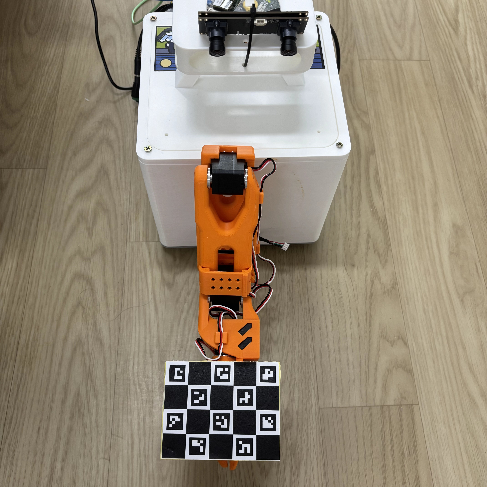

# 手眼标定

`perceptive_grasp` 使用公共标定会话采集 eye-to-hand 数据，计算 RGB-D 相机到机械臂基座的变换。
采集通过 `manipulation` 读取关节反馈，结果与其他应用共用同一标定格式。

## 1. 安装相机和标定板

RGB-D 相机固定在机身上，ChArUco 标定板固定在夹爪末端。如图所示：

<p align="center">
  
</p>

## 2. 准备标定环境

标定前确认：

- `config/grasp_pipeline.yaml` 中的 `camera.type` 和相机参数与当前硬件一致。
- 机械臂串口可访问，机械臂周围没有障碍物。
- Python 环境已安装 `requirements.txt` 中的依赖。
- `manipulator.device_plan`、`model` 和 `calibration_resources` 指向本台机械臂的设备配置、模型及舵机校准文件。
- RGB-D 相机和机械臂基座已经固定，标定完成前不再调整安装位置。

激活环境：

```bash
cd ~/spacemit_robot/application/ros2/linksee/perceptive_grasp
source ~/spacemit_robot/build/envsetup.sh
source ~/.venv-grasp/bin/activate
```

标定脚本读取 `camera.type`，支持 RealSense D435i 和 `spacemit_las2` 双目相机。`spacemit_las2` 标定只采集校正后的逻辑左目彩色图，不启动深度推理。

LAS2 须在 `camera.spacemit_las2.serial` 填写本台相机的序列号或固定资产编号；此字段用于登记设备身份，不自动核验 USB 设备。

## 3. 生成并打印 ChArUco 标定板

生成 4 × 5 ChArUco 标定板：

```bash
python3 scripts/generate_charuco_board.py \
  --squares-x 4 \
  --squares-y 5 \
  --square-length 0.020 \
  --marker-length 0.014 \
  --output config/charuco_4x5_20mm_14mm.png
```

输出文件位于：

```text
config/charuco_4x5_20mm_14mm.png
```

按 100% 比例打印标定板，测量一个黑白方格和一个 ArUco marker 的实际边长，再将标定板刚性固定在夹爪末端。采集命令必须使用实测尺寸，单位为米。

## 4. 采集标定样本

下面的示例尺寸对应 20 mm 方格和 14 mm marker：

```bash
python3 scripts/calibrate_hand_eye.py \
  --config config/grasp_pipeline.yaml \
  --installation-id linksee_site \
  --charuco-squares-x 4 \
  --charuco-squares-y 5 \
  --charuco-square-length 0.020 \
  --charuco-marker-length 0.014 \
  --max-distance 0.60 \
  --num-poses 15 \
  --dataset-dir output/hand_eye
```

采集程序不使能、不关闭扭矩、不发送运动目标。采集时遵守以下要求：

- 按现场规程调整姿态并停止，退出其他控制程序后按回车采集（输入 `CAPTURE` 等效），输入 `q` 结束。
- 每次采样独占设备，完成后释放连接。手动调整前须按设备规程支撑机械臂，不能强行拖动带力矩的关节。
- 标定板须相对模型末端刚性固定；采集期间不得改变夹爪开度。

`installation-id` 标识固定的机械臂、相机与标定板安装。会话绑定模型、设备配置、校准文件、相机内参和板尺寸，资源变化后须新建数据目录。

关节参考系按驱动反馈处理：

- 驱动明确报告关节未校准时，程序拒绝采集。
- 驱动不提供参考系确认时，须核实模型和编码器零位后显式追加 `--confirm-joint-reference`；该声明不等于驱动验证。

注意事项：

1. 采集姿态应覆盖工作空间的左、中、右、高、低位置以及不同腕部角度。相邻姿态至少改变两个关节，并保持标定板正面朝向相机。
2. 标定板应完整位于画面内。marker 边长低于 40 px（`--min-marker-size-px`）只提示不拒收，尺寸读数仍记入样本；精度由重投影误差把关，标定板靠得近、成像清晰时容易通过。
3. 标定板到相机的距离默认限制在 0.10~0.40 m（`--min-distance`、`--max-distance`），推荐 0.20~0.30 m，超出上界报 `marker too far` 并拒收。需要更远的样本时放宽上界，示例取 0.60 m。远距样本约束深度方向，单帧精度不如近距，因此 0.20~0.30 m 的样本应占多数，远距只补覆盖；求解输出的残差表明显变大就把上界收回。
4. 只有通过质量检查的样本才会写入数据集，记录关节反馈、末端与标定板位姿、重投影误差和 marker 尺寸，并保存采集图像。被拒收时屏幕给出原因，调整姿态后重试即可。

## 5. 求解并写回配置

使用采集时相同的安装标识和数据目录：

```bash
python3 scripts/calibrate_hand_eye.py \
  --solve-only \
  --installation-id linksee_site \
  --dataset-dir output/hand_eye \
  --apply-config config/grasp_pipeline.yaml
```

脚本将结果写入：

```yaml
calibration:
  <camera.type>:
    T_base_camera:
      translation: [x, y, z]
      rotation: [roll, pitch, yaw]
```

脚本仅导出通过质量要求的结果，根据会话中的相机后端更新对应配置块，并备份原文件。

- `translation`：单位为米。
- `rotation`：单位为弧度。

默认质量门槛为最大位置残差 5 mm、最大角度残差 2°，留出样本与全量样本都要满足。未达标时报 `Report quality failed`，并列出实际最差残差与所用门槛。此时先看样本分布：个别样本明显偏离，删掉重采比放宽门槛更划算。若整体散布均匀、只是略超门槛，可用 `--solve-max-position-m`、`--solve-max-angle-deg` 放宽后重解，上限为 15 mm / 5°，超过上限的残差仍判为不达标：

```bash
python3 scripts/calibrate_hand_eye.py \
  --solve-only \
  --installation-id linksee_site \
  --dataset-dir output/hand_eye \
  --solve-max-position-m 0.010 \
  --solve-max-angle-deg 4.0 \
  --apply-config config/grasp_pipeline.yaml
```

放宽后 `result.json` 的 `thresholds` 记录实际使用的门槛，`quality_passed` 只表示残差落在该门槛内，不表示精度等同默认门槛。抓取精度要求高时，仍应以 5 mm / 2° 为准重新采集。

旧数据集仍支持离线重算，不补造设备身份或校准来源。

## 6. 验证标定结果

先检查运行环境：

```bash
python3 scripts/check_runtime_env.py \
  --config config/grasp_pipeline.yaml \
  --no-fix
```

再使用定位工具检查目标在机械臂基座坐标系中的位置：

```bash
./build/debug_localize \
  --config config/grasp_pipeline.yaml \
  --target banana \
  --frames 5
```

输出的 `base_point_m` 应与目标相对机械臂基座的实际位置一致。出现稳定方向偏差或固定距离偏差时，不要通过抓取偏移掩盖问题，应重新检查标定板尺寸、样本覆盖和相机安装稳定性。
